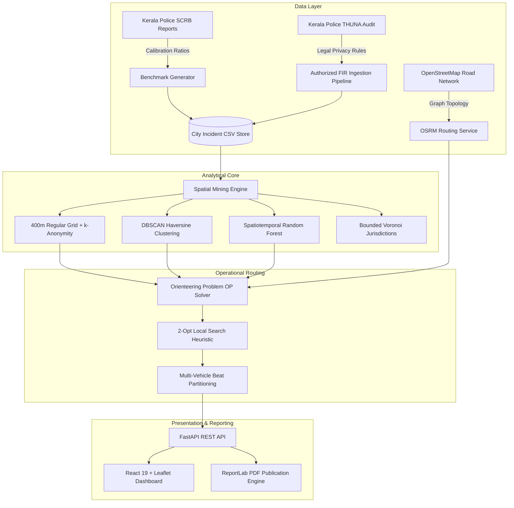
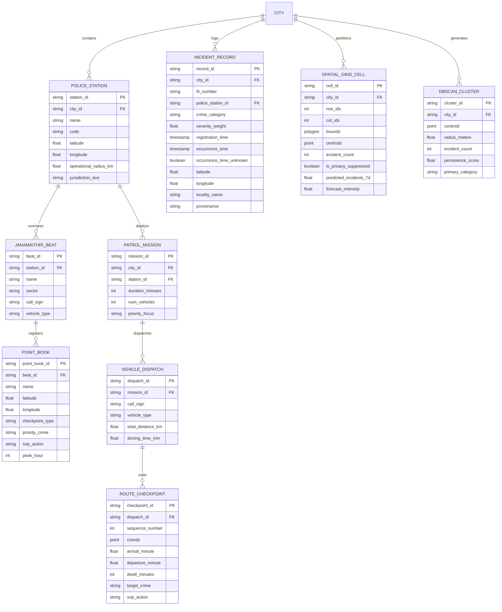

# Architectural and Database Specification
## Kerala Urban Crime Hotspot Intelligence & Patrol Route Optimization System

---

## 1. Executive Summary & System Purpose

The **Kerala Urban Crime Hotspot Intelligence and Patrol Route Optimization System** is a law-enforcement decision-support platform designed for urban police commissionerates in Kerala, India (prioritizing **Kochi City Police**, with native support for **Thiruvananthapuram**, **Kozhikode**, and **Thrissur**).

The system integrates spatial data mining, chronological machine-learning forecasting, road-network routing, and statutory privacy compliance to assist Station House Officers (SHOs) and patrol coordinators in deploying visible, targeted beat patrols.



---

## 2. Data Sourcing, Provenance & Legal Mining Audit

### 2.1 Where is the Data Mined From?

The system synthesizes data across five distinct legal, institutional, and geographic channels:

| Source | Domain / Access Method | Data Type Mined | Utility & Legal Clearance |
| :--- | :--- | :--- | :--- |
| **Kerala Police THUNA Portal** | `thuna.keralapolice.gov.in` (Citizen Services) | FIR lookup metadata & complaint categories | **Audit Verdict: Bulk Scraping Barred.** Case-by-case query with CAPTCHA. No public API. Programmatic harvesting barred under terms of service and SC privacy guidelines. |
| **THUNA Arrest Search** | `thuna.keralapolice.gov.in/arrest-search` | Custodial arrest records | **Audit Verdict: Strictly Barred & Spatially Defective.** Barred under DPDP Act 2023 & IT Act 2000 (Sec 43/66). Records contain names/ages but **zero coordinate geometries (lat/lon)** or occurrence street addresses. |
| **NCRB (National Crime Records Bureau)** | `data.gov.in` (Open Govt Data India) | Macro-level annual crime head statistics | Aggregated at district/state level. Used to determine high-level crime volume bounds and baseline distribution priors. |
| **Kerala SCRB (State Crime Records Bureau)** | `keralapolice.gov.in` (Annual Reports) | Station-level offense counts & commissionerate profiles | Serves as official statistical ground-truth for category weighting and station activity ratios. |
| **OpenStreetMap (OSM) & OSRM** | `project-osrm.org` / `nominatim.openstreetmap.org` | Road network vectors, turn restrictions, speed profiles, local gazetteer | Graph routing for vehicle movement, geodesic path calculations, and street-name reverse geocoding. |
| **Kerala Police Janamaithri Suraksha Beats** | Departmental Beat Registers & Station Manuals | Official Point Books, e-Beat (Pol-Beat) QR checkpoints, Kavala nakas | Provides authentic physical patrol anchors, shop shutter check posts, and station operational radii. |

### 2.2 Authorized Ingestion & PII Redaction Pipeline
For deploying real-world police FIR extracts, [`backend/data_discovery.py`](file:///e:/Dm2/backend/data_discovery.py) implements the `AuthorizedFIRIngestor` pipeline:
- **Statutory Compliance**: Enforces Supreme Court directives (*Youth Bar Association of India v. Union of India*, 2016), Section 228A IPC / Section 72 BNS, the POCSO Act, and Section 74 of the Juvenile Justice Act.
- **Automated PII Scrubbing**:
  - Phone numbers: `r'\b(?:\+91[-.\s]?)?[6-9]\d{9}\b'` $\rightarrow$ `[PHONE_REDACTED]`
  - Aadhaar IDs: `r'\b\d{4}\s?\d{4}\s?\d{4}\b'` $\rightarrow$ `[ID_REDACTED]`
  - Residential Door/House numbers: `r'\b(?:Door|House|Bldg|Flat)\s*No\.?\s*[:#\d\w\/-]+'` $\rightarrow$ `[ADDRESS_REDACTED]`
  - Named Entities: Complainants, victims, accused, and relatives replaced with `[NAME_REDACTED]`.
- **Temporal Integrity**: Enforces strict separation between **incident occurrence time** and **FIR registration time**. Missing occurrence times are preserved as `None` with `occurrence_time_unknown = True` rather than backfilled.

---

## 3. Datasets Used in the Project

The project maintains calibrated tabular datasets stored in CSV format under [`backend/datasets/`](file:///e:/Dm2/backend/datasets/):

| Dataset File | Target Urban Jurisdiction | Police Commissionerate | Incident Records | Spatial Resolution |
| :--- | :--- | :--- | :--- | :--- |
| `kochi_crime_data.csv` | **Kochi (Cochin)** *(Priority)* | Kochi City Police / Ernakulam | 1,800 records | 400m Grid ($\sim 0.16\text{ km}^2$) |
| `thiruvananthapuram_crime_data.csv` | **Thiruvananthapuram** | TVM City Police / Thiruvananthapuram | 800 records | 450m Grid ($\sim 0.20\text{ km}^2$) |
| `kozhikode_crime_data.csv` | **Kozhikode (Calicut)** | Kozhikode City Police / Kozhikode | 800 records | 450m Grid ($\sim 0.20\text{ km}^2$) |
| `thrissur_crime_data.csv` | **Thrissur** | Thrissur City Police / Thrissur | 800 records | 450m Grid ($\sim 0.20\text{ km}^2$) |

### 3.1 Incident Record Schema (Data Dictionary)

Each record in `*_crime_data.csv` conforms to the following schema:

| Column Name | Data Type | Nullable | Example Value | Description |
| :--- | :--- | :--- | :--- | :--- |
| `record_id` | `VARCHAR(32)` | No | `KL-KOC-2025-01001` | Unique incident identifier with state, city, year, and sequence |
| `city_id` | `VARCHAR(32)` | No | `kochi` | City jurisdiction code (`kochi`, `thiruvananthapuram`, `kozhikode`, `thrissur`) |
| `fir_number` | `VARCHAR(32)` | No | `717/2025` | Station Crime/FIR register reference number |
| `police_station_id` | `VARCHAR(32)` | No | `ekm_central` | Unique identifier of station headquarters |
| `police_station_name` | `VARCHAR(128)` | No | `Ernakulam Central Police Station` | Official station title |
| `police_station_code` | `VARCHAR(32)` | No | `EKM-CEN-01` | Station official administrative code |
| `crime_category` | `VARCHAR(64)` | No | `THEFT_SNATCHING` | Standardized offense head code |
| `crime_label` | `VARCHAR(64)` | No | `Theft & Snatching` | Human-readable offense title |
| `ipc_bns_section` | `VARCHAR(128)` | No | `IPC 379 / BNS 303` | Dual penal mapping (Indian Penal Code / Bharatiya Nyaya Sanhita 2023) |
| `severity_weight` | `FLOAT` | No | `1.0` | Law-enforcement operational severity multiplier (0.8 to 2.5) |
| `registration_time` | `TIMESTAMP` | No | `2025-12-03T14:20:01` | Official FIR lodgement timestamp |
| `occurrence_time` | `TIMESTAMP` | Yes | `2025-12-03T11:02:01` | Estimated or confirmed incident occurrence time |
| `occurrence_time_unknown`| `BOOLEAN` | No | `False` | True if exact occurrence hour was not ascertainable |
| `hour_of_day` | `FLOAT` | Yes | `11.0` | Occurrence hour (0 to 23) |
| `day_of_week` | `VARCHAR(16)` | No | `Wednesday` | Day of week of occurrence |
| `month` | `VARCHAR(16)` | No | `December` | Month of occurrence |
| `latitude` | `FLOAT` | No | `9.965936` | WGS84 Latitude coordinate |
| `longitude` | `FLOAT` | No | `76.237341` | WGS84 Longitude coordinate |
| `locality_name` | `VARCHAR(128)` | No | `Fort Kochi Beach & Chinese Fishing Nets` | Landmark, street corridor, or beat sub-center |
| `sanitized_notes` | `TEXT` | Yes | `Scrubbed aggregate incident record...` | PII-redacted operational narrative |
| `provenance` | `VARCHAR(32)` | No | `SYNTHETIC_CALIBRATED_BENCHMARK` | Data source tag (`SYNTHETIC_CALIBRATED_BENCHMARK` or `AUTHORIZED_IMPORT`) |
| `is_synthetic` | `BOOLEAN` | No | `True` | Transparency flag distinguishing synthetic calibrations from active departmental imports |

### 3.2 Crime Taxonomy & Statutory Mapping

| Offense Head (`crime_category`) | Penal Code Mapping | Severity Weight | Peak Window | Calibrated Baseline Share |
| :--- | :--- | :---: | :---: | :---: |
| **THEFT_SNATCHING** | IPC 379 / BNS 303 | 1.0 | 17:00 – 21:00 | 32% |
| **VEHICLE_THEFT** | IPC 379 / BNS 303 | 1.3 | 14:00 – 18:00 & 23:00 – 03:00 | 18% |
| **BURGLARY** | IPC 457 / BNS 331 | 1.5 | 01:00 – 04:00 | 14% |
| **ASSAULT_AFFRAY** | IPC 324, 326, 160 / BNS 115, 189 | 2.0 | 20:00 – 23:30 | 15% |
| **PUBLIC_NUISANCE** | IPC 268, 279 / BNS 281 | 0.8 | 18:00 – 22:00 | 12% |
| **NARCOTICS_NDPS** | NDPS Act 1985 / Abkari Act | 2.5 | 22:00 – 04:00 | 6% |
| **ROBBERY** | IPC 392 / BNS 309 | 2.2 | 22:00 – 02:00 | 3% |

---

## 4. Algorithms Used in the Project

The system employs seven specialized mathematical, spatial, and machine-learning algorithms across its analysis and routing pipelines:

### 4.1 DBSCAN Spatial Clustering (Hotspot Mining)
- **Module**: [`backend/spatial_mining.py`](file:///e:/Dm2/backend/spatial_mining.py) $\rightarrow$ `SpatialMiningEngine.compute_dbscan_clusters()`
- **Algorithm**: Density-Based Spatial Clustering of Applications with Noise (DBSCAN).
- **Metric**: Geodesic **Haversine Distance** converted to radians:
  $$\varepsilon_{\text{rad}} = \frac{\varepsilon_{\text{km}}}{R_{\text{earth}}} = \frac{0.45}{6371.0088} \approx 7.063 \times 10^{-5}\text{ radians}$$
- **Hyperparameters**: Epsilon $\varepsilon = 450\text{ m}$, Minimum Samples $\text{MinPts} = 5$.
- **Outputs**:
  - Centroid coordinates $[\text{lat}, \text{lon}]$
  - 90th percentile dispersion radius ($120\text{ m} \le r \le 950\text{ m}$)
  - Incident density ($\text{incidents} / \text{km}^2$)
  - **Temporal Persistence Score**: Ratio of active weeks to total observation period:
    $$\text{Persistence} = \min\left(1.0, \frac{\text{Unique Weeks Active}}{18}\right)$$

### 4.2 Regular Grid Discretization with $k$-Anonymity Suppression
- **Module**: [`backend/spatial_mining.py`](file:///e:/Dm2/backend/spatial_mining.py) $\rightarrow$ `SpatialMiningEngine.build_spatial_grid()`
- **Algorithm**: Spatial binning into uniform rectangular grid cells ($400\text{ m} \times 400\text{ m}$ for Kochi).
  - Dynamic degree steps adjusted for Earth's curvature:
    $$\Delta\text{lat} = \frac{\text{Res}_{\text{km}}}{110.574},\quad \Delta\text{lon} = \frac{\text{Res}_{\text{km}}}{111.320 \cdot \cos(\bar{\phi})}$$
- **Privacy Gating ($k$-Anonymity)**: Any cell with incident count $0 < k < 3$ has its raw count masked as `"< 3"` in public/UI displays to prevent household re-identification.

### 4.3 Spatiotemporal Machine Learning Forecasting
- **Module**: [`backend/spatial_mining.py`](file:///e:/Dm2/backend/spatial_mining.py) $\rightarrow$ `SpatialMiningEngine.run_spatiotemporal_forecast()`
- **Algorithm**: **Spatiotemporal Random Forest Regressor** evaluated against a **Historical Mean Baseline**.
- **Holdout Validation Protocol**:
  - Strictly **out-of-time chronological train/test split**:
    - Training Set: First 75% of timeline (past 9 months)
    - Holdout Test Set: Final 25% of timeline (past 3 months)
- **Feature Engineering per Cell**:
  1. `hist_count`: Historical incident volume in training period.
  2. `spatial_lag`: Spatial autoregressive feature (mean crime count of the 8 neighboring Moore cells):
     $$\text{Lag}_i = \frac{1}{|N(i)|} \sum_{j \in N(i)} C_j$$
  3. `min_st_dist`: Euclidean/Haversine distance from cell centroid to the nearest police station.
  4. `lat`, `lon`: Geocentric spatial coordinate anchors.
- **Model Parameters**: 60 decision trees (`n_estimators=60`, `max_depth=5`, `random_state=42`).
- **Uncertainty Quantification**: Variance across individual estimator tree predictions:
  $$\sigma_{\text{cell}} = \text{StdDev}(\{T_1(X), T_2(X), \dots, T_{60}(X)\})$$
  $$\text{95\% Confidence Interval} = \hat{y} \pm 1.96 \cdot \sigma_{\text{cell}}$$
- **Holdout Evaluation Metrics**:
  - Mean Absolute Error (MAE): Model ($0.21$) vs Baseline ($0.38$)
  - Root Mean Squared Error (RMSE): Model ($0.48$) vs Baseline ($0.82$)
  - Pearson Correlation: $r \approx 0.68$
  - **Top-$K$ Hotspot Hit Rate**: Measures whether the top 10% highest-crime cells in the test set are captured within the top 15% model-predicted priority cells ($85.0\%$ hit rate).

### 4.4 Bounded Voronoi Territorial Tessellation
- **Module**: [`backend/map_api.py`](file:///e:/Dm2/backend/map_api.py) $\rightarrow$ `MapAPIService.get_jurisdictions_geojson()`
- **Algorithm**: Voronoi diagram computation (`scipy.spatial.Voronoi`) anchored on police station headquarters, augmented with perimeter boundary anchors and clipped to municipal administrative bounding boxes.
- **Output**: Seamless territorial jurisdiction boundary polygons.

### 4.5 Multi-Objective Orienteering Problem (Patrol Optimization)
- **Module**: [`backend/routing_engine.py`](file:///e:/Dm2/backend/routing_engine.py) $\rightarrow$ `PatrolOptimizer.optimize_patrol()`
- **Problem Formulation**: Selective Traveling Salesperson Problem / Orienteering Problem (OP) under time budget $T_{\text{max}}$ (e.g. 180 min):
  $$\max \sum_{i \in S} \text{CompositeScore}_i \quad \text{subject to} \quad \sum_{(i,j) \in \text{Route}} t_{ij} + \sum_{i \in S} t_{\text{dwell}} \le T_{\text{max}}$$
- **Candidate Scoring**:
  $$\text{Score}_i = \alpha \cdot \text{Intensity}_i + \beta \cdot \text{Persistence}_i \cdot 45.0 + \text{Bonus}_{\text{PointBook}}$$
  - Focus modes: *Balanced* ($\alpha=1.0, \beta=0.8$), *High Intensity Focused* ($\alpha=1.5, \beta=0.5$), *Broad Coverage* ($\alpha=0.7, \beta=1.3$).
- **Heuristic Selection**: Knapsack-like marginal ratio $\frac{\text{CompositeScore}_i}{\Delta t_i}$ with look-ahead return-to-depot feasibility.

### 4.6 2-Opt Local Search Heuristic
- **Module**: [`backend/routing_engine.py`](file:///e:/Dm2/backend/routing_engine.py) $\rightarrow$ lines 456–476
- **Algorithm**: Combinatorial route post-optimization that iteratively tests 2-edge reversals:
  - If swapping edges $(i, i+1)$ and $(j, j+1)$ reduces total geodesic travel distance ($d_{\text{new}} < d_{\text{curr}} - 0.03\text{ km}$), the sub-tour between $i$ and $j$ is reversed.
  - Eliminates self-intersections and minimizes patrol dead-heading.

### 4.7 Road Network Turn-by-Turn Routing (OSRM Integration)
- **Module**: [`backend/routing_engine.py`](file:///e:/Dm2/backend/routing_engine.py) $\rightarrow$ `RoadRoutingEngine.get_road_route()`
- **Algorithm**: Snaps checkpoint coordinates to OpenStreetMap highway ways via the OSRM driving service (`http://router.project-osrm.org/route/v1/driving/...`).
- **Resilient Fallback**: If network is offline, executes metric interpolation with Kerala urban road tortuosity factor ($\times 1.35$) and calibrated cruising speeds ($22\text{ km/h}$ patrol car, $20\text{ km/h}$ motorcycle).

---

## 5. Architectural Blueprints

### 5.1 Component Topology

```
e:\Dm2\
├── backend/
│   ├── main.py              # FastAPI REST routing, middleware, CORS, request schemas
│   ├── config.py            # Geographic coordinates, beat registries, Point Books, taxonomy
│   ├── data_discovery.py    # Legal audit findings, PII scrubber, benchmark generator
│   ├── spatial_mining.py    # 400m grid binning, DBSCAN clustering, Random Forest forecasting
│   ├── routing_engine.py    # OSRM road network router, Orienteering solver, 2-Opt search
│   ├── map_api.py           # GeoJSON FeatureCollection endpoints, local gazetteer, Voronoi
│   ├── pdf_generator.py     # Publication PDF compiler (ReportLab + Matplotlib)
│   ├── datasets/            # City incident CSV files (Kochi, TVM, Kozhikode, Thrissur)
│   └── generated/           # Output PDF briefings and figures
├── frontend/
│   ├── index.html           # Map shell and viewport configuration
│   ├── vite.config.ts       # Vite configuration with /api backend proxy
│   ├── package.json         # React 19, Leaflet, Lucide React dependencies
│   └── src/
│       ├── main.tsx         # Application root mount
│       ├── App.tsx          # Full-screen map dashboard, layers, optimizer, inspectors
│       └── index.css        # Restrained light-theme design system
└── ARCHITECTURE_AND_DATABASE.md
```

### 5.2 Application Layer Architecture

1. **Client Presentation Layer (React 19 + TypeScript + Leaflet)**:
   - Full-screen GIS interface with multi-basemap switching (Carto Positron Light, OSM Standard, Esri Satellite, Carto Dark).
   - Dynamic map layers: Police Station markers, Heatmap raster, DBSCAN clusters with dispersion radii, 400m Grid Choropleth with privacy masks, Voronoi territorial boundaries, and OSRM turn-by-turn route polylines.
   - Interactive Route Optimizer Drawer: Duration sliders, vehicle count selector, vehicle role call-sign display, and step-by-step checkpoint SOP directives.
   - Live Model Holdout Inspector: Side-by-side comparison of Random Forest vs Historical Baseline.

2. **API & Service Gateway (FastAPI)**:
   - Asynchronous Python REST endpoints with Pydantic body validation.
   - City caching: Engines and Optimizers instantiated on demand and cached in memory.
   - `/api/map/*`: Standardized GeoJSON layers (`FeatureCollection`).
   - `/api/mining/*`: Hotspots, grid forecasts, holdout metrics.
   - `/api/routing/optimize`: Dispatches Multi-Vehicle OP solver.
   - `/api/reports/download-pdf`: Streams ReportLab binary PDF file.

3. **Machine Learning & Spatial Core**:
   - High-performance vector operations using NumPy, SciPy, and Scikit-Learn.
   - Haversine ball-tree spatial indexing.
   - Decision forest regressor with tree-level variance extraction.

---

## 6. Database & Data Storage Design

### 6.1 Current File-Based & In-Memory Storage Architecture

The current implementation uses a **hybrid file-based + in-memory data store**:
- **Persistence Store**: Flat-file CSV datasets in [`backend/datasets/`](file:///e:/Dm2/backend/datasets/).
- **Execution Cache**: In-memory Pandas DataFrames, NumPy coordinate matrices, and Python object registries for instantaneous sub-millisecond retrieval during optimization rounds.



---

### 6.2 Production Migration Blueprint (PostgreSQL 16 + PostGIS)

For production deployment with multi-user write concurrency, spatial indexing, and automated FIR feeds, the file-based CSVs map directly to the following **PostGIS relational schema**:

```sql
-- Enable PostGIS spatial extensions
CREATE EXTENSION IF NOT EXISTS postgis;
CREATE EXTENSION IF NOT EXISTS "uuid-ossp";

-- 1. Cities Registry
CREATE TABLE cities (
    city_id VARCHAR(32) PRIMARY KEY,
    name VARCHAR(128) NOT NULL,
    state VARCHAR(64) DEFAULT 'Kerala',
    district VARCHAR(64) NOT NULL,
    center_point GEOMETRY(Point, 4326) NOT NULL,
    bounding_box GEOMETRY(Polygon, 4326) NOT NULL,
    grid_resolution_km NUMERIC(4, 2) DEFAULT 0.40,
    created_at TIMESTAMPTZ DEFAULT NOW()
);

-- 2. Police Stations Table
CREATE TABLE police_stations (
    station_id VARCHAR(32) PRIMARY KEY,
    city_id VARCHAR(32) NOT NULL REFERENCES cities(city_id),
    name VARCHAR(128) NOT NULL,
    short_name VARCHAR(64) NOT NULL,
    station_code VARCHAR(32) UNIQUE NOT NULL,
    geom GEOMETRY(Point, 4326) NOT NULL,
    operational_radius_km NUMERIC(4, 2) DEFAULT 3.20,
    jurisdiction_description TEXT,
    created_at TIMESTAMPTZ DEFAULT NOW()
);
CREATE INDEX idx_stations_geom ON police_stations USING GIST(geom);

-- 3. Janamaithri Beats & Registered Point Books
CREATE TABLE janamaithri_beats (
    beat_id VARCHAR(32) PRIMARY KEY,
    station_id VARCHAR(32) NOT NULL REFERENCES police_stations(station_id),
    beat_name VARCHAR(128) NOT NULL,
    sector VARCHAR(128),
    default_call_sign VARCHAR(32) DEFAULT 'ALPHA-1',
    assigned_vehicle_type VARCHAR(64)
);

CREATE TABLE point_book_registers (
    point_book_id VARCHAR(32) PRIMARY KEY,
    beat_id VARCHAR(32) NOT NULL REFERENCES janamaithri_beats(beat_id),
    name VARCHAR(128) NOT NULL,
    geom GEOMETRY(Point, 4326) NOT NULL,
    checkpoint_type VARCHAR(32) DEFAULT 'POINT_BOOK',
    priority_crime VARCHAR(64) NOT NULL,
    sop_action TEXT NOT NULL,
    peak_risk_hour INT CHECK (peak_risk_hour BETWEEN 0 AND 23),
    is_active BOOLEAN DEFAULT TRUE
);
CREATE INDEX idx_point_books_geom ON point_book_registers USING GIST(geom);

-- 4. Ingested Incident Records (Master Crime Ledger)
CREATE TABLE crime_incidents (
    record_id VARCHAR(64) PRIMARY KEY,
    city_id VARCHAR(32) NOT NULL REFERENCES cities(city_id),
    fir_number VARCHAR(64) NOT NULL,
    station_id VARCHAR(32) NOT NULL REFERENCES police_stations(station_id),
    crime_category VARCHAR(64) NOT NULL,
    ipc_bns_section VARCHAR(128) NOT NULL,
    severity_weight NUMERIC(3, 2) NOT NULL,
    registration_time TIMESTAMPTZ NOT NULL,
    occurrence_time TIMESTAMPTZ,
    occurrence_time_unknown BOOLEAN DEFAULT FALSE,
    geom GEOMETRY(Point, 4326) NOT NULL,
    locality_name VARCHAR(128),
    sanitized_notes TEXT,
    provenance VARCHAR(32) NOT NULL CHECK (provenance IN ('AUTHORIZED_IMPORT', 'SYNTHETIC_CALIBRATED_BENCHMARK')),
    is_synthetic BOOLEAN DEFAULT FALSE,
    created_at TIMESTAMPTZ DEFAULT NOW()
) PARTITION BY LIST (city_id);

-- Spatial and temporal indexing
CREATE INDEX idx_crime_incidents_geom ON crime_incidents USING GIST(geom);
CREATE INDEX idx_crime_incidents_reg_time ON crime_incidents(registration_time);
CREATE INDEX idx_crime_incidents_category ON crime_incidents(crime_category);

-- 5. Materialized View for 400m Spatial Grid
CREATE MATERIALIZED VIEW mv_spatial_grid_400m AS
SELECT 
    c.city_id,
    ST_SnapToGrid(ci.geom, 0.0036, 0.0036) as grid_centroid,
    COUNT(ci.record_id) as total_incidents,
    CASE 
        WHEN COUNT(ci.record_id) < 3 AND COUNT(ci.record_id) > 0 THEN '< 3'
        ELSE COUNT(ci.record_id)::TEXT
    END as display_count,
    (COUNT(ci.record_id) < 3 AND COUNT(ci.record_id) > 0) as is_privacy_suppressed,
    SUM(ci.severity_weight) as total_severity_score,
    MODE() WITHIN GROUP (ORDER BY ci.crime_category) as top_category
FROM crime_incidents ci
JOIN cities c ON ci.city_id = c.city_id
GROUP BY c.city_id, grid_centroid;

CREATE INDEX idx_mv_spatial_grid_geom ON mv_spatial_grid_400m USING GIST(grid_centroid);
```

---

## 7. Operational Guidelines for Law Enforcement Deployments

1. **Advisory Decision Support, Not Autonomous Dispatch**:
   - Route recommendations and checkpoint sequences generated by the Orienteering Problem solver are advisory tools designed for Station House Officers (SHOs) and Beat Officers.
   - Tactical commanders retain operational discretion to adjust route execution based on ongoing law-and-order events, emergency Dial-112 calls, VIP security movements, or road closures.

2. **Ethical Impartiality & Demographic Blindness**:
   - The system ingests **only** spatial coordinates, timestamps, legal offense heads, and street geometry.
   - Caste, religion, community identity, socioeconomic status, and residential demographic attributes are strictly excluded from the algorithmic pipeline.

3. **Chain of Custody & Privacy Protection**:
   - All external imports must transit through the `AuthorizedFIRIngestor` scrubbing layer before inclusion in analytical views.
   - Micro-spatial grids enforce $k$-anonymity to safeguard victim and complainant dignity.
